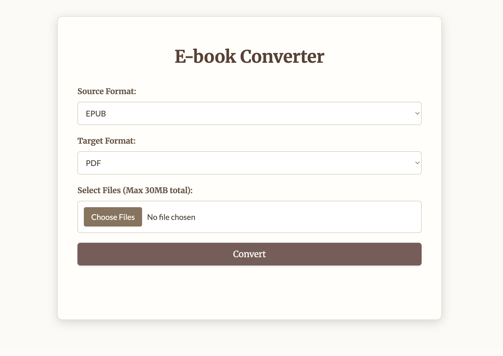

# E-book Converter



I needed to turn a stack of EPUBs into MOBI for my Kindle and PDF for an AI reading assistant. Every "free" online converter I tried had a file limit, a queue, or a very well-hidden subscription. So I built this instead: a local Flask app with a "bookish" theme that converts EPUB, MOBI, and PDF, on my machine, for free, without asking what I'm reading.

## What it does

*   **A UI that doesn't look like a spreadsheet:** clean, "bookish" theme, because this converts books.
*   **PDF, EPUB, and MOBI**, any format to any other format.
*   **File upload that respects your time:**
    *   Select one file or fifty.
    *   Client-side validation catches a mismatched format before you waste a conversion attempt.
    *   Configurable upload cap (default 30MB per request).
*   **The actual conversion engine is Calibre's `ebook-convert`**, because Calibre has been solving this exact problem for over a decade and reinventing it would just be ego.
*   **Downloads that make sense:**
    *   Convert one file, get one download link.
    *   Convert a batch, get one ZIP (`converted_files.zip`, or `converted_files (n).zip` if you run it twice).
*   **Real error messages**, not a spinner that dies silently.
*   **Session-scoped file handling:** your uploads and outputs live in a session-specific temp folder, not a shared bucket with everyone else's books.

## Technology Stack

*   **Backend:** Python, Flask
*   **Conversion:** Calibre (`ebook-convert` command-line tool)
*   **Frontend:** HTML, CSS, JavaScript
*   **Fonts:** Google Fonts (Merriweather for headings, Lato for body text)

## Prerequisites

1.  **Python 3.7+:** Ensure Python 3.7 or newer is installed. You can download it from [python.org](https://www.python.org/).
2.  **Calibre:** The core conversion functionality relies on the `ebook-convert` tool, which is part of the Calibre e-book management software.
    *   Download and install Calibre from its official website: [https://calibre-ebook.com/download](https://calibre-ebook.com/download).
    *   **Crucially, ensure that the directory containing `ebook-convert` is added to your system's PATH environment variable.** The application attempts to find it in common locations (e.g., `/Applications/calibre.app/Contents/MacOS/ebook-convert` on macOS), but having it in the PATH is the most reliable method. The application will show a warning on startup if `ebook-convert` cannot be found, and conversions will fail.
3.  **pip:** Python's package installer (usually comes with Python).

## Setup and Installation

1.  **Clone the Repository or Download Files:**
    ```bash
    # If this project were a Git repository:
    # git clone <repository_url>
    # cd <repository_name>
    ```
    Alternatively, download all project files (`app.py`, `book_converter_utils.py`, `requirements.txt`, `templates/index.html`, `static/style.css`, `static/script.js`) and place them in a single project directory.

2.  **Create and Activate a Virtual Environment (Highly Recommended):
    ```bash
    # Navigate to your project directory
    cd /path/to/your/project_directory

    # Create a virtual environment (e.g., named 'env')
    python3 -m venv env

    # Activate the virtual environment
    # On macOS/Linux:
    source env/bin/activate
    # On Windows (Git Bash or similar):
    # source env/Scripts/activate
    # On Windows (Command Prompt/PowerShell):
    # env\Scripts\activate.bat 
    ```

3.  **Install Python Dependencies:**
    With your virtual environment activated, install the required Python packages:
    ```bash
    pip install -r requirements.txt
    ```

4.  **Verify `ebook-convert` Installation (Optional but Recommended):
    Open your terminal (with the virtual environment activated if you use one for Calibre as well, though usually Calibre is system-wide) and type:
    ```bash
    ebook-convert --version
    ```
    If this command displays a version number, Calibre's tool is correctly installed and accessible in your PATH. If not, please revisit the Calibre installation prerequisite.

## Running the Application

1.  Ensure you are in the project directory in your terminal.
2.  Make sure your Python virtual environment is activated (if you created one).
3.  Start the Flask development server:
    ```bash
    python app.py
    ```
4.  The application will start. By default, it runs on `http://127.0.0.1:5001/`.
    Open this URL in your web browser to use the E-book Converter.

## How to Use the Web Interface

1.  **Open the Application:** Navigate to `http://127.0.0.1:5001/` in your browser.
2.  **Select Source Format:** Choose the format of the e-book files you intend to upload (PDF, EPUB, or MOBI).
3.  **Select Target Format:** Choose the format you want your files converted to.
4.  **Choose Files:** 
    *   Click the "Select Files" area.
    *   A file dialog will open. Select one or more e-book files from your computer that match the chosen "Source Format".
    *   The application has client-side validation to alert you if selected files don't match the source format.
5.  **Convert:** Click the "Convert" button to start the upload and conversion process.
6.  **Monitor Progress:** A status message will indicate that files are being processed.
7.  **Download Results:**
    *   Upon completion, a list of converted files will appear under "Converted Files:".
    *   Each successfully converted file will have an individual "Download" link.
    *   If multiple files were processed, a "Download All as ZIP" button will also be available. This will download a single archive named `converted_files.zip` (or `converted_files (1).zip`, etc., if the name is already taken in the server's `converted_files` directory).
    *   Any errors encountered during conversion for specific files will be listed under an "Errors:" section.

## Project Structure

```
. (project_root)
├── app.py                     # Main Flask application logic, routes
├── book_converter_utils.py    # Utility functions (find ebook-convert, file naming, conversion call)
├── requirements.txt           # Python package dependencies
├── README.md                  # This file - detailed project information
├── templates/
│   └── index.html             # HTML template for the main user interface
├── static/
│   ├── style.css              # CSS styles for the "bookish" theme
│   └── script.js              # Client-side JavaScript for form handling, AJAX, UI updates
├── uploads/                   # Root directory for temporary uploaded files (created automatically)
│   └── [session_id]/          # Session-specific subdirectories for uploaded files
└── converted_files/           # Root directory for converted files and ZIP archives (created automatically)
    └── [session_id]/          # Session-specific subdirectories for individual converted files
    └── converted_files (n).zip # ZIP archives for batch downloads
```

## The honest limitations

This is a tool I run on my own laptop, not a startup, so here's what it doesn't do:

*   **It needs Calibre.** No `ebook-convert` in your PATH means no conversions. That's the whole engine.
*   **It doesn't clean up after itself.** Uploaded and converted files sit in `uploads/<session_id>/` and `converted_files/<session_id>/` forever. Fine for personal use, a real problem if you leave this running on a shared server for months. Add a cron job or wipe the folders yourself.
*   **30MB upload cap by default.** Change `app.config['MAX_CONTENT_LENGTH']` in `app.py` if your books are chunkier than that.
*   **This is Flask's dev server**, not something you point the public internet at. Put Gunicorn or uWSGI behind it if you're actually deploying this somewhere.
*   **Basic security only.** `secure_filename` is in there, nothing more. Don't expose this to strangers without adding real input validation and rate limiting first.
*   **Single process.** It converts your books, not everyone's books at once. If you need that, you're building a different, more annoying product.

## Customization

*   **File size limit:** `app.config['MAX_CONTENT_LENGTH']` in `app.py`.
*   **Styling:** `static/style.css` and `templates/index.html`.
*   **Non-standard `ebook-convert` location:** adjust `find_ebook_convert_path` in `book_converter_utils.py`.

## License

MIT. See LICENSE.
